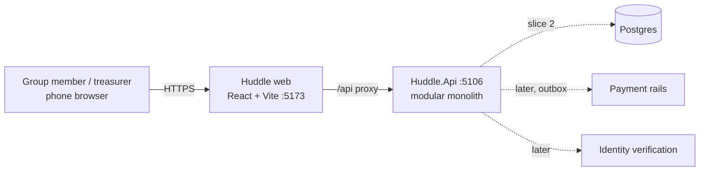

# Architecture

## Style and why
Modular monolith (Accounts, Groups, Payments, Statements) with a double-entry, append-only ledger and an idempotency key on every money command. One deployable keeps "check wallet, append entries, remember key" a single local transaction for a five-person team. Full comparison of options and the evolution trigger: `docs/DESIGN.md` section 4 and `decisions/0001-architecture-style.md`.

Advisor summary (`arch-advisor compare`, launch and global profiles): ModularMonolith recommended; CQRS read models and an event-sourced core are good alternatives; microservices and serverless are poor fits (small team, consistency-critical money). Evolve when one module needs separate scaling or a separate regulatory boundary: extract only that module.

## Context

## Modules and boundaries
| Project | Owns | Public surface | May call |
|---|---|---|---|
| `src/Huddle.Api` | composition root: endpoints, DI, ProblemDetails, dev identity, health checks, demo seed | `HuddleApi.Build` | all module contracts |
| `src/Huddle.SharedKernel` | `Money` (long cents + ISO currency), `LedgerAccounts`, `PostingKinds`, module contracts | contracts only | nothing |
| `src/Modules/Accounts` | ledger accounts, postings, entries (`InMemoryLedger`) | `ILedger` | nothing |
| `src/Modules/Groups` | people, groups, roles, per-contribution limits | `IGroupDirectory`, `IGroupRegistry` | nothing |
| `src/Modules/Payments` | contribution use case, rules, idempotency store, metrics | `IContributions` | `ILedger`, `IGroupDirectory` |
| `src/Modules/Statements` | contribution history, running balance, totals per member | `IStatements` | `ILedger` |

Rules, enforced by `tests/Huddle.Tests/Architecture/ModuleBoundaryTests.cs`: a module references only `Huddle.SharedKernel`; a module exports exactly one public type (`XModule`); SharedKernel references no module and no web framework.

Ledger rules: no balance column anywhere (balance = sum of entries); a posting is accepted only if its lines sum to zero in one currency; no update or delete API; concurrency by per-account locks taken in ordinal order, with overdraft checks inside the lock.

## Cross-cutting
- **Auth:** development `X-Member-Id` header via `DemoMemberAuthenticationHandler`; refused outside Development unless `Auth:AllowDemoHeader=true`. OIDC later.
- **Errors:** RFC 9457 ProblemDetails, `type = urn:huddle:problem:<reason>`, extension `reason`, `errors` for field problems, `traceId`.
- **Time:** `TimeProvider` injected everywhere (tests use a fixed clock). "This month" is computed in SAST (UTC+2).
- **Telemetry:** meter `Huddle.Payments` (posted, replayed, rejected by reason); OpenTelemetry exporter when the package feed is available.
- **Health:** `/health/live` (process), `/health/ready` (ledger integrity check).
- **Config:** `Auth:AllowDemoHeader`, `Seed:Demo` (seed also runs in Development).
