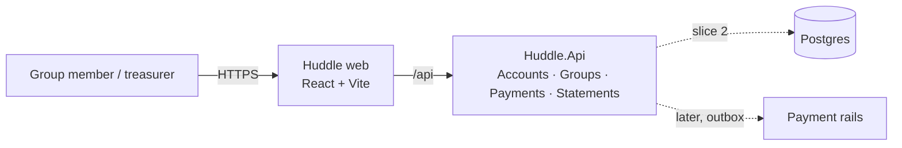

# Huddle

A digital banking app for stokvel savings groups, built for Thrive Mutual (fictional), a financial cooperative. Every name, user and number in this repo is invented.

## Design at a glance
**Brief.** Stokvel groups track contributions in notebooks and chat threads, so treasurers can't prove balances and members don't trust the totals. Huddle lets a member pay their contribution from a phone, exactly once, and shows everyone a group balance that is provably the sum of ledger entries.

**Architecture.** A .NET 8 modular monolith with four modules (Accounts, Groups, Payments, Statements) that talk only through contracts in a shared kernel. Money moves through a double-entry, append-only ledger: no balance column anywhere, every posting sums to zero, and every contribution carries an `Idempotency-Key`. We chose one deployable because a contribution must check membership, check the wallet, append entries and remember the key in one local transaction, and a five-person team should not run a distributed system for that. Microservices, serverless and event sourcing were compared and rejected for now; the evolution trigger is a module needing its own scaling or regulatory boundary. Full reasoning, diagrams, capacity sums and failure modes: [docs/DESIGN.md](docs/DESIGN.md).



## What it does today (slice 1)
- Stokvel group screen: group balance, this month's progress, members, contribution history with balance after each payment.
- Contribute dialog: amount in rand and cents, a fresh idempotency key per attempt, safe automatic retries on network errors.
- API: `GET /api/me`, `GET /api/groups/{id}`, `GET /api/groups/{id}/contributions`, `POST /api/groups/{id}/contributions` (requires `Idempotency-Key`), `GET /api/ledger/integrity`, `/health/live`, `/health/ready`.
- Rules: non-members get 403; amounts must be more than zero, whole cents and within the member's per-contribution limit (422 ProblemDetails with a `reason`); same key and body returns the original receipt, same key with another body returns 409.
- Data is in memory and seeded with invented demo data in Development. Persistence is slice 2.

## Run locally
```bash
ASPNETCORE_URLS=http://localhost:5106 ASPNETCORE_ENVIRONMENT=Development dotnet run --project src/Huddle.Api
cd web && npm ci && npm run dev    # http://localhost:5173
```
Tests: `dotnet test` and `cd web && npx vitest run`. More in `.agentic/runbook.md`.

## How this project is organised
`src/Huddle.Api` (composition root), `src/Huddle.SharedKernel` (Money + contracts), `src/Modules/*` (one project per module), `tests/Huddle.Tests`, `web/`. Project knowledge lives in the hidden `.agentic/` folder (start with `.agentic/README.md`); AI agents read `AGENTS.md` first.

Built with the Baton model from the Agentic Engineering Kit: frame → map → decide → sketch → slice loop → pass the baton.
