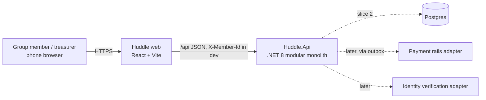
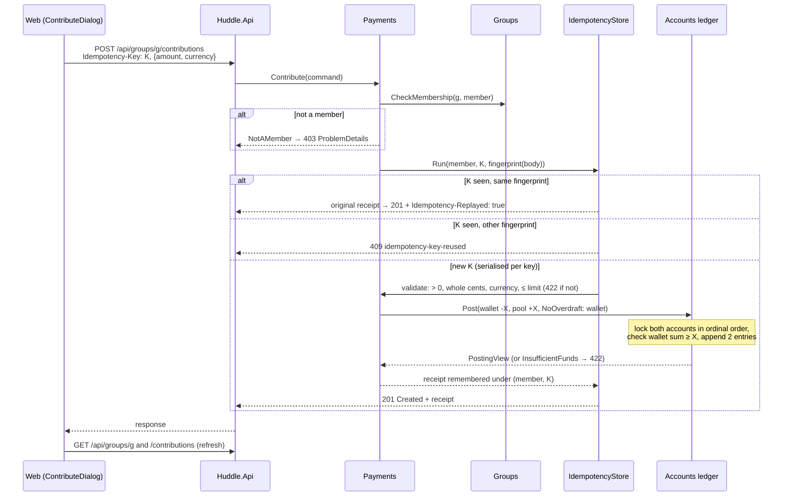
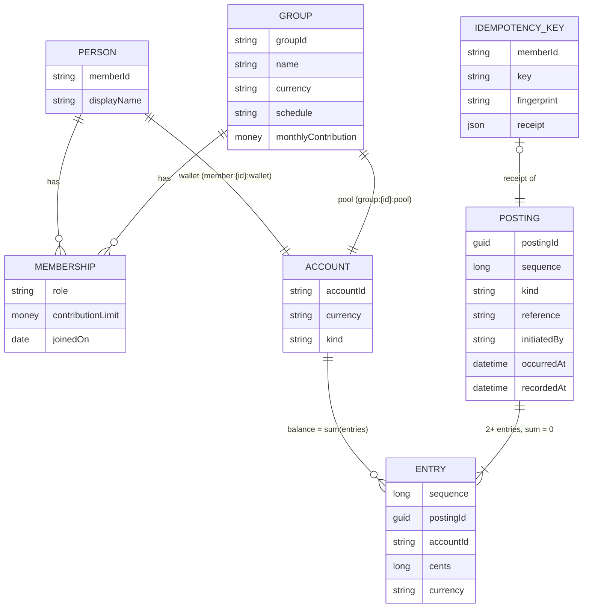

# Huddle: design dossier

> Showcase project. Thrive Mutual (fictional) and every name, user and number here are invented.
> State: slice 1 built (contribute to a stokvel group, balance from ledger entries). In-memory stores; Postgres is slice 2.

## 1. Brief
- **Client:** Thrive Mutual (fictional), a financial cooperative for stokvel savings groups.
- **Problem:** groups track contributions in notebooks and chat threads, so treasurers can't prove balances and members don't trust the totals.
- **Users:** group members (weekly, on a phone, often on patchy data); treasurers (weekly, need statements); compliance (monthly).
- **Outcomes:** every balance provable from ledger entries; a retried payment never pays twice; a monthly group statement in one click.

## 2. Requirements
**Functional (slice 1, built):** a member contributes from their wallet to their group; everyone in the group sees the balance (sum of ledger entries), the members and the contribution history; non-members get 403; amounts must be > 0, whole cents and within the member's per-contribution limit.
**Next:** persistence (slice 2), statements and payouts with KYC, real sign-in.

| Non-functional | Target | Where it is enforced |
|---|---|---|
| Money correctness | every posting sums to zero; balance = sum of entries; no float | `InMemoryLedger`, `Money` (long cents), property tests |
| Exactly-once contributions | same key + same body = same receipt; different body = 409 | `IdempotencyStore`, parallel tests |
| Availability | 99.9% API success over 30 days | SLO in `.agentic/quality.md` |
| Latency | p95 < 300 ms for group read and contribute | SLO; in-memory today |
| Retention | ledger kept forever (append-only); personal data per POPIA, deletable on exit | slice 2 schema |
| Privacy | other members' limits and wallets never shown; logs carry ids, not names | `GroupResponse` shape |

## 3. Capacity estimate
Assumptions (rounded up): year 1 = 20 000 groups x 12 members = 240 000 members; each member contributes about once a month; group screen opened 10x per contribution.
- **Writes:** 240k contributions/month. Payday clustering: 40% in the 3 days around the 25th → 32k/day; busiest hour 15% → ~5k/h ≈ **1.5 writes/s peak**.
- **Reads:** 10x → **~15 reads/s peak** (group + history = 2 requests each, so ~30 HTTP req/s).
- **Storage:** a contribution = 1 posting + 2 entries ≈ 0.5 KB with indexes. Contributions, funding and payouts ≈ 6M postings/year → **~3 GB/year**.
- **Bandwidth:** group + history ≈ 12 KB per view → 30 req/s x 6 KB ≈ 0.2 MB/s peak.
- **At 100x (global profile):** 24M members → ~150 writes/s, ~3 000 HTTP req/s peak, ~300 GB/year. Still one Postgres primary for writes; reads need a cache or read model (section 9).

## 4. Options considered
`arch-advisor compare` with the launch traits (MoneyMovement, RegulatoryAudit, PersonalData, SeveralBusinessAreas, ExternalPartnerIntegrations, ComplexBusinessRules, SmallTeam):

| Option | Fit | Complexity (1-5) | Main reason |
|---|---|---|---|
| Modular monolith | Recommended | 3 | Matches the advisor's recommended style (ModularMonolith). |
| Modular monolith + CQRS read models | Good alternative | 3 | Same family as the recommendation; valid if its trade-offs suit the team. |
| Event-sourced core with CQRS | Good alternative | 4 | Same family as the recommendation; valid if its trade-offs suit the team. |
| Static site + serverless function | Poor fit | 1 | Real server-side behaviour and data; a static site can't hold it. |
| Layered monolith | Poor fit | 1 | Several business areas would tangle without module boundaries. |
| Vertical slice monolith | Poor fit | 2 | Several business areas would tangle without module boundaries. |
| Clean Architecture monolith | Poor fit | 2 | Several business areas would tangle without module boundaries. |
| Serverless functions + queues | Poor fit | 3 | Consistency-critical money operations are awkward across stateless functions. |
| Microservices (request/response) | Poor fit | 5 | A small team can't run a distributed system well (deployments, tracing, on-call). |
| Event-driven microservices | Poor fit | 5 | A small team can't run a distributed system well (deployments, tracing, on-call). |

The global-scale profile (same traits without SmallTeam) gives the same ranking; the only change is the microservices reason: "pays the distributed-systems tax with no independent scaling need".

- **Modular monolith (chosen).** Four business areas need hard boundaries, but money needs one transaction around "check wallet, append entries, remember key". One deployable and one database keep that a local transaction for a five-person team.
- **+ CQRS read models.** Not yet: at ~15 reads/s, summing a group's entries is cheap. First step on the scaling path once group screens get hot.
- **Event-sourced core.** The append-only ledger already gives auditors full history of money. Event-sourcing everything (groups, members) adds versioning and projections for no current need. ADR-0001 trigger: only if auditors need point-in-time replay beyond the ledger.
- **Microservices / serverless.** A contribution touches Groups (membership, limit) and Accounts (ledger) at once; splitting them means a saga for every payment and a distributed on-call for a small team.
- **CRUD with a balance column** (rejected in ADR-0001): balances drift and can't be proven.

**Evolution trigger (ADR-0001):** stay a modular monolith until a module needs separate scaling or a separate regulatory boundary; then extract that module only.

## 5. Architecture


```mermaid
flowchart TB
  subgraph Api[Huddle.Api: composition root]
    ep[HuddleEndpoints<br/>/api/me, /api/groups/{id}, /contributions, /api/ledger/integrity]
    auth[DemoMemberAuthenticationHandler]
    hc[LedgerIntegrityHealthCheck<br/>/health/live, /health/ready]
    seed[DemoSeeder - Development only]
  end
  subgraph SK[Huddle.SharedKernel]
    money[Money, LedgerAccounts, PostingKinds]
    contracts[ILedger, IGroupDirectory, IGroupRegistry,<br/>IContributions, IStatements]
  end
  acc[Accounts<br/>InMemoryLedger]
  grp[Groups<br/>InMemoryGroupStore]
  pay[Payments<br/>ContributionService, ContributionRules,<br/>IdempotencyStore, PaymentsMetrics]
  st[Statements<br/>LedgerStatements]
  ep --> contracts
  acc -- implements ILedger --> contracts
  grp -- implements IGroupDirectory/IGroupRegistry --> contracts
  pay -- implements IContributions, uses ILedger + IGroupDirectory --> contracts
  st -- implements IStatements, uses ILedger --> contracts
```

| Module | Owns | Public surface | May call |
|---|---|---|---|
| Accounts | ledger accounts, postings, entries | `ILedger` | nothing |
| Groups | people, groups, roles, per-contribution limits | `IGroupDirectory`, `IGroupRegistry` | nothing |
| Payments | contribution use case, rules, idempotency keys | `IContributions` | `ILedger`, `IGroupDirectory` |
| Statements | contribution history, running balance, member totals | `IStatements` | `ILedger` |

Each module exposes one public type (`XModule.AddXModule()`); everything else is `internal`. `ModuleBoundaryTests` fail if a module assembly or csproj references another module, or exports more than its registration class.

## 6. Communication flows
All calls are synchronous, in-process. Slice 1: contribute.


Riskiest flow: the network drops after the server posted.
```mermaid
sequenceDiagram
  participant W as Web
  participant A as Huddle.Api
  W->>A: POST (key K) – attempt 1
  A-->>W: 201 lost on the network
  Note over W: TypeError → wait 400 ms, same key K
  W->>A: POST (key K) – attempt 2
  A-->>W: 201 same receipt, Idempotency-Replayed: true
  Note over W,A: one posting, one pair of entries; 4xx is never retried; 502/503/504 are
```
Outbox: not needed in slice 1 (no external call). Payouts to payment rails will write the ledger posting and an outbox row in one transaction; a worker delivers it with the posting id as the partner's idempotency key.

## 7. Data flow
```mermaid
flowchart LR
  in1[Member input: amount [money]] --> v[ContributionRules<br/>validate]
  in2[Identity header: member id [PII]] --> m[Membership check]
  m --> v --> k[IdempotencyStore<br/>member + key + body hash]
  k --> l[(Ledger: postings + entries [money]<br/>append-only)]
  reg[Onboarding / seed: names [PII], roles, limits] --> g[(Groups store [PII])]
  l --> s[Statements: history, running balance]
  g --> s
  s --> out[Group screen JSON<br/>names, totals, amounts]
  l --> h[Integrity check → /health/ready]
```
[money] marks money, [PII] marks personal data. Personal data in slice 1 is display names only; ID numbers, phone numbers and bank details (KYC, slice 3+) go in a separate encrypted store with read logging.

## 8. Data model

| Entity | Module | Consistency |
|---|---|---|
| Account, Posting, Entry | Accounts | strong: one posting is atomic; per-account locks (slice 2: one DB transaction, `SELECT … FOR UPDATE` on wallet) |
| Person, Group, Membership | Groups | strong within the module |
| Idempotency key | Payments | strong with the posting (slice 2: same transaction) |
| Contribution history | Statements | derived on read from entries (no copy, so never stale) |

There is no balance column anywhere. A balance is always `SUM(entries.cents)` for the account.

## 9. Scaling path
1. **Postgres (slice 2):** ledger tables append-only (no UPDATE/DELETE grants); index entries by `(account_id, sequence)`. Good to ~150 writes/s.
2. **Hot group reads:** cache the group response per group, invalidated by the posting sequence; or a read model of running balances per account, rebuilt from entries and checked against them nightly.
3. **Wallet contention:** one member rarely posts in parallel, so per-wallet locks are cheap; the pool account is a hot key on payday → stop locking credit-only accounts (only overdraft-guarded accounts need the lock), or shard the pool into sub-accounts summed on read.
4. **Statements:** monthly statements as a background job writing PDFs; reads from a replica.
5. **Extract a module** (ADR trigger): Payments with payment rails is the first candidate (separate regulatory boundary), talking to Accounts through the same `ILedger` contract over HTTP + outbox.

## 10. Failure modes
| Failure | Effect | Mitigation |
|---|---|---|
| Duplicate request (retry, double tap) | could pay twice | `Idempotency-Key` per attempt, scoped to member; replay returns original receipt; parallel same-key test |
| Same key, different amount | ambiguous intent | 409 `idempotency-key-reused`, nothing posted |
| Parallel contributions from one wallet | overdraft | wallet locked during check + append; test: 50 x R30 on R1 000 → exactly 33 succeed |
| Network drop after commit | member unsure if paid | client retries with the same key; UI says "you will not be charged twice" |
| Unbalanced posting (bug) | money created or lost | ledger rejects any posting not summing to zero; `/health/ready` fails if integrity breaks |
| Process restart (slice 1) | in-memory data lost | known limit of slice 1; slice 2 persists |
| Payment rail down (later) | payouts delayed | outbox + retry with jitter + circuit breaker; ledger already correct |
| Hot pool account on payday | lock waits | see scaling step 3 |
| Region outage | API down | single region at launch; Postgres PITR backups; RTO 4 h / RPO 5 min target |

## 11. Security and privacy
- **AuthN:** slice 1 uses a development header (`X-Member-Id`) behind an authentication handler; the app refuses to start outside Development unless `Auth:AllowDemoHeader=true`. Real OIDC sign-in replaces the handler, endpoints stay the same.
- **AuthZ:** membership checked on every group read and every contribution (403 `not-a-member`); keys scoped per member so one member can't replay another's key.
- **Data minimisation:** the group response shows names, roles and paid status, never other members' limits or wallets. POPIA: KYC data later in a separate encrypted store, access logged, erasable; ledger entries keep only pseudonymous ids so history survives erasure.
- **Secrets:** none in slice 1; later from a vault, never appsettings. Privacy guard and secret scan run in CI.
- **Threats per flow:** contribute (replay → idempotency; tampering with amount → server-side rules; enumeration of groups → 404/403 without detail); read (IDOR on groupId → membership check).

## 12. Observability
- **SLIs/SLOs:** in `.agentic/quality.md` (API success 99.9%, p95 < 300 ms, ledger integrity 100%, replay share).
- **Metrics:** meter `Huddle.Payments`: `huddle.contributions.posted`, `.replayed`, `.rejected{reason}`. ASP.NET Core request metrics.
- **Traces/logs:** `traceId` in every ProblemDetails; OpenTelemetry exporter added when the package feed is available (NuGet was blocked for this slice).
- **Wake-someone alert:** `/health/ready` unhealthy (ledger out of balance) or contribute 5xx burning the error budget 10x faster than allowed for 5 minutes.

## 13. Testing strategy
| Layer | What | Where |
|---|---|---|
| Rules | `Money`, `ContributionRules`, `RequestFingerprint` | `tests/Huddle.Tests/Domain`, `Payments/ContributionRulesTests.cs` |
| Ledger invariants | property loops: 5 000 random balanced postings over 3 fixed seeds, 2 000 random unbalanced attempts; sum to zero and balance = sum of entries | `Ledger/LedgerInvariantPropertyTests.cs` |
| Concurrency | 200 parallel contributions add up; 50 parallel on a small wallet never overdraw; 40 parallel same-key → one posting | `Payments/ConcurrencyTests.cs` |
| HTTP | real Kestrel on a free port with seed data: 401/403/404/409/422, replay header, ProblemDetails shape, health | `Api/ApiTests.cs` |
| Boundaries | no cross-module references, one public type per module, no float in Money | `Architecture/ModuleBoundaryTests.cs` |
| Web | money parsing/formatting, retry keeps one key, dialog states | `web/src/**/*.test.ts(x)` (vitest) |

Acceptance criteria → tests: (1) same key twice → `Criterion1_*` (module + HTTP); (2) balances = entries, sum zero → property tests + `Criterion2_*`; (3) member sees, non-member 403 → `Criterion3_*`; (4) bad amounts → `Criterion4_*`.

## 14. Interview questions
1. **Why no balance column?** A stored balance can drift from the entries and can't be proven. Summing entries is the proof; at scale, a cached read model is checked against entries rather than trusted.
2. **What if the contribute request arrives twice?** Same member + key + body → the stored receipt is returned with `Idempotency-Replayed: true`; nothing is posted. Concurrent duplicates serialise on the key, so only one can post.
3. **Why 409 for same key, different body?** The client is confused (a bug or a reused key); guessing which amount they meant could move the wrong money.
4. **How do you stop two parallel contributions overdrawing a wallet?** The ledger locks every account in the posting in a fixed order, checks the wallet sum and appends while holding the lock. In Postgres: one transaction with `FOR UPDATE` on the wallet row.
5. **Why can't two postings deadlock?** Locks are always taken in ordinal account-id order.
6. **How would you scale group reads to 10M members?** Cache per group keyed by the latest posting sequence; then a read model of balances; the write path doesn't change.
7. **Why are failed attempts not remembered under the key?** A 422 posts nothing, so letting the member fix the amount with the same key is safe; only successful receipts are binding.
8. **How do modules stay apart?** They share only contracts in `Huddle.SharedKernel`; architecture tests fail on any module-to-module reference.
9. **When would you split into services?** When Payments needs its own regulatory boundary or scaling (ADR-0001 trigger), extract it behind the same contracts with an outbox.
